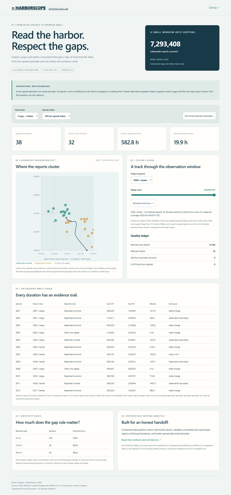

# HarborScope — Shipping Data Lab

Reproducible AIS shipping-data analysis: screen a nationwide archive, extract cargo/tanker observations near Los Angeles and Long Beach, and reconstruct **observed low-speed dwell episodes** with explicit coverage boundaries.

**[Open the lab](https://ehsan-ch.github.io/harborscope-ais-lab/)** · [Research method](RESEARCH.md) · [Source manifest](data/source_manifest.json)



## The historical sample

| Measure | Result |
|---|---:|
| Nationwide AIS reports screened | 7,293,408 |
| Reports inside study rectangle | 105,092 |
| Retained cargo/tanker reports | 12,506 |
| Cargo / tanker vessels | 22 / 14 |
| Observed dwell episodes | 38 across32 vessels |
| Sum of observed spans | 582.8 vessel-hours |
| Median observed span | 19.9 hours |
| Episode states | 16 reported-moored,18 reported-anchor,4 other low-speed |

Date: **1January2024 UTC**, one historical holiday. The study rectangle is latitude33.65–33.85, longitude−118.30–−118.13; it is not an official port boundary. Dwell episodes are not verified port calls, berth occupancy or waiting time. Long episodes often reach the observation boundary:21 end there, and27 begin there. True physical activity may extend beyond the sample.

## Inspect and test

Python3.11/3.12 and Node22+; no API keys or Node dependencies:

```sh
python -m pip install -r requirements.txt
python -m unittest discover -s tests -p "test_*.py"
python verify.py
npm test
npm start
```

Open http://127.0.0.1:8799/. Filter the episode ledger by cargo/tanker class and reported state. Select a project vessel ID and move the replay clock to inspect its sampled track. Download the selected episode CSV.

The position plot has longitude/latitude axes and an approximate local aspect ratio. It deliberately has no coastline, berth or navigation layer. The replay masks future track reports; episode circles and aggregate statistics remain retrospective full-day results.

## Rebuild

```sh
python download.py
python build.py
python verify.py
```

The download is a196,492,824-byte Zstandard archive from the current NOAA distribution endpoint. The old ZIP links returned404 during preparation; the [current archive index](https://noaaocm.blob.core.windows.net/ais/csv2/csv2024/index.html) supplied the replacement. `download.py` records and checks a local SHA256 integrity pin. There is no claimed independent publisher checksum. A changed archive stops the pipeline for review.

Raw files stay in ignored `data/raw/`. The nationwide CSV is decompressed and read row by row; only the study-area commercial subset is retained in memory. `points.csv` contains the12,506 validated observations under project vessel IDs. Raw MMSI, vessel names, IMO and call signs are not included in the reduced output. Project IDs are for presentation and do not guarantee anonymity against the original public archive.

To rebuild the report from the included retained observations without downloading the nationwide archive:

```sh
python build.py --from-points
```

## Episode contract

- Cargo/tanker AIS type codes70–89; finite valid coordinates, study-day timestamps, speed0–50knots and status0–15.
- Identical vessel/timestamp duplicates keep one report. Conflicting records at the same vessel/timestamp are all rejected. None were detected in the retained sample.
- Low speed means SOG≤0.5knots. Status5 is **reported moored**,1 is **reported at anchor**, and other statuses are **other low-speed**.
- An episode needs at least two reports spanning≥20minutes, adjacent gaps≤15minutes, the same state, and every point within500metres of its first report.
- Vessel changes, state changes, larger gaps, radius limits and the last observation terminate the observed episode. Missing time beyond the final accepted report is never added.
- Duration is the elapsed span between observed reports, assuming continuity within the allowed gaps; it does not verify every intervening minute.

The gap sensitivity analysis produces250 episodes at5minutes versus38 at15 or30minutes. This shows reporting cadence can dominate apparent episode counts. It is not a congestion ranking or a tuned selection of the most attractive result.

## Engineering and validation

`analysis.py` implements deterministic segmentation. `build.py` handles schema mapping, streaming extraction, quality counts, project IDs, sampled tracks and sensitivity. `verify.py` recalculates every episode and sensitivity summary from `points.csv`, reconciles report totals and checks integrity pins. Twelve Python tests cover gaps, radius limits, state changes, duplicate conflicts, durations and boundary behavior. Four JavaScript tests reconcile browser statistics, filters, CSV and replay masking. CI runs Python3.11/3.12 and Node22; it does not redownload the national archive.

See `VERIFICATION.md` for publication and observed browser checks after release. Original code is MIT. Source credit: NOAA Office for Coastal Management, BOEM and U.S. Coast Guard / Marine Cadastre. See [DATA_NOTES.md](DATA_NOTES.md) for provider constraints and attribution. Independent historical research, with no provider affiliation or live tracking service.
